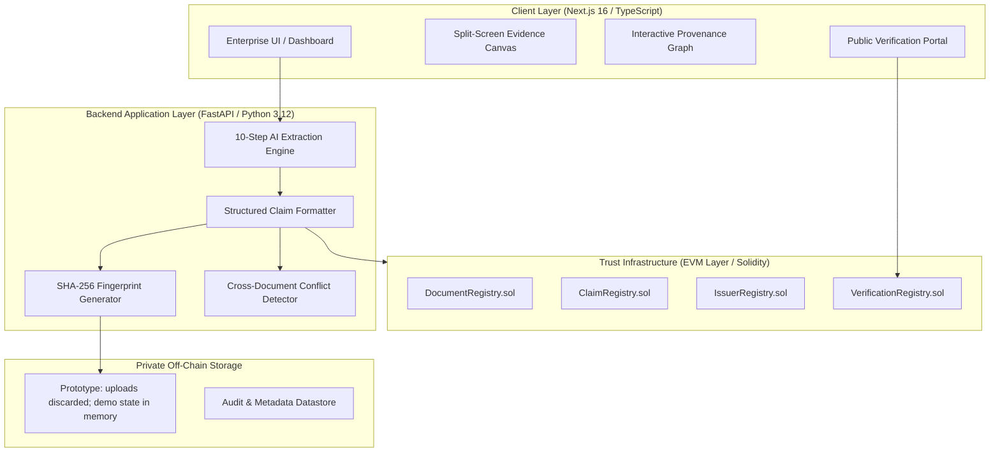

# VERITAS System Architecture & Technical Specification

> **Prototype boundary:** This document describes the intended architecture and the current demo implementation. The current backend uses in-memory seeded data; the extraction pipeline is simulated; uploads are hashed and discarded; the demo ledger is simulated; and neither encryption at rest nor zero-knowledge proofs are implemented. Do not treat demo status labels as legal findings or production cryptographic attestations. See README.md for setup and full limitations.

## 1. High-Level Architectural Overview

VERITAS is built upon a hybrid architecture designed to decouple heavy AI document understanding from lightweight, tamper-evident cryptographic provenance.



---

## 2. Key Modules

### 2.1 The 10-Step AI Processing Pipeline
Rather than instant, non-traceable outputs, VERITAS executes a modular 10-step ingestion sequence:
1. **Document Ingestion**: File type parsing, DPI normalization, multi-page chunking.
2. **Language & Script Detection**: Identification of regional languages (English, Hindi, Bengali, Tamil, etc.).
3. **Visual Token Extraction**: Neural OCR generating text tokens with exact pixel bounding boxes.
4. **Document Structure Analysis**: Recognition of official crests, seals, stamps, and schedules.
5. **Entity Extraction**: Disambiguation of titleholders, survey numbers, parcels, and issuing authorities.
6. **Claim Generation**: Conversion into atomic `(Subject, Predicate, Object)` assertions.
7. **Evidence Mapping**: Calculating normalized coordinates $(x, y, w, h)$ bounding each claim.
8. **Cross-Document Consistency Check**: Comparing new claims against all prior documents in the repository.
9. **Integrity Fingerprinting**: Generating SHA-256 commitment of the source file.
10. **Verification Packaging**: Preparing a demo package with selected evidence and claim metadata. No zero-knowledge proof is generated.

### 2.2 Contradiction Engine
When multiple documents reference the same physical entity (e.g. `Land Parcel 184/2`), the Contradiction Engine clusters claims sharing the same predicate (`ownedBy`). If multiple distinct values are detected (e.g., `Rahul Sharma` vs. `Rohan Sharma`):
- Severity is set to `HIGH`.
- Status transitions to `REQUIRES HUMAN REVIEW`.
- **System Axiom**: AI extraction $\neq$ legal truth. The system highlights the discrepancy but does not automatically determine legal ownership.

### 2.3 The Privacy-Preserving Third-Party Verification Model
Third-party verifiers do not need access to the full raw document. When verifying `claim-1`:
- Verifier queries `/verify/claim-1`.
- The API delivers:
  - Claim triple: `Subject: Land Parcel 184/2 | Predicate: ownedBy | Object: Rahul Sharma`
  - Document SHA-256 fingerprint and simulated anchor state (no live chain lookup).
  - Seeded demo issuer verification status (no live signature check).
  - Targeted evidence snippet and bounding box coordinates for that claim only.
  - The selected evidence snippet is returned; the full source document is not included.

---

## 3. Data Model Specification

### Claim Object
```typescript
interface Claim {
  id: string;
  subject: string;
  predicate: string;
  object: string;
  confidence: number;            // 0.00 - 1.00
  confidenceTier: 'HIGH' | 'MEDIUM' | 'LOW';
  sourceDocumentId: string;
  sourceDocumentName: string;
  sourcePage: number;
  evidenceRegion: {
    page: number;
    x: number;                    // 0 - 100% horizontal coordinate
    y: number;                    // 0 - 100% vertical coordinate
    width: number;
    height: number;
  };
  rawSnippet: string;
  issuerId: string;
  issuerName: string;
  issuerVerified: boolean;
  createdAt: string;
  integrityStatus: 'VERIFIED' | 'UNVERIFIED' | 'TAMPER_SUSPECT';
  verificationStatus: 'VERIFIED' | 'PENDING_REVIEW' | 'CONFLICT' | 'REVOKED';
  blockchainAnchor: {
    isAnchored: boolean;
    network: string;
    txHash: string | null;
    blockNumber: number | null;
    timestamp: string | null;
    status: string;
    gasUsed?: number;
  };
  hasConflict: boolean;
  conflictId?: string | null;
}
```

---

## 4. Blockchain Layer Architecture

VERITAS uses four distinct smart contracts deployed on EVM:

1. **`DocumentRegistry.sol`**:
   - `registerDocument(bytes32 documentHash, address issuer, string documentType, bytes32 metadataCommitment)`
   - `verifyDocument(bytes32 documentHash) view returns (...)`
   - `revokeDocument(bytes32 documentHash, string reason)`

2. **`ClaimRegistry.sol`**:
   - `registerClaim(bytes32 claimHash, bytes32 documentHash, bytes32 evidenceCommitment, string predicate)`
   - `attestClaim(bytes32 claimHash)`
   - `revokeClaim(bytes32 claimHash, string reason)`

3. **`IssuerRegistry.sol`**:
   - `registerIssuer(address issuer, string name, string jurisdiction, string publicKeyURI)`
   - `verifyIssuer(address issuer)`
   - `revokeIssuer(address issuer, string reason)`

4. **`VerificationRegistry.sol`**:
   - `logVerification(bytes32 claimHash, bool isAuthentic, bytes32 evidenceCommitment, string verificationMethod)`
   - Provides public auditability of third-party checks.
